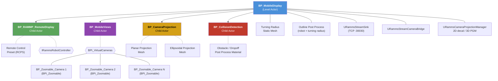
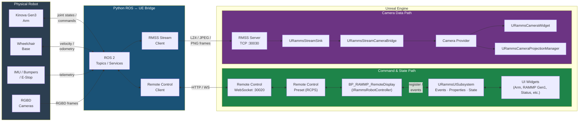
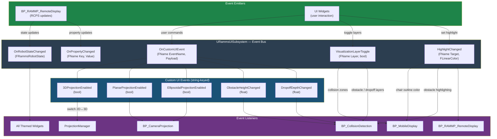

# RammpUI

Unreal Engine 5.8 project implementing the user interface for the **RAMMP**
(Robotic Autonomous Mobile Manipulation Platform) prototype. Provides real-time
RGBD camera streaming, 3D point cloud (PGM) visualization, robot teleoperation,
modular UI layouts, and a Python-scriptable control layer.

## Architecture

```
┌──────────────────────────────────────────────────────────────────────┐
│                          RammpUI  (UE 5.8)                           │
│                                                                      │
│  ┌─────────────┐  ┌──────────────┐  ┌────────────┐  ┌─────────────┐  │
│  │  RammsCore  │  │CameraCapture │  │RammsAssets │  │  RammpUI    │  │
│  │             │  │              │  │            │  │  Module     │  │
│  │ Kinova Gen3 │  │ RGB / Depth  │  │ Meshes     │  │ Game logic  │  │
│  │ Wheelchair  │  │ Motion Vec   │  │ Materials  │  │ & maps      │  │
│  │ Gripper     │  │ Intrinsics   │  │ Textures   │  │             │  │
│  │ Sensors     │  │ Extrinsics   │  │            │  │             │  │
│  └──────┬──────┘  └──────┬───────┘  └────────────┘  └───────┬─────┘  │
│         │                │                                  │        │
│         │        ┌───────┴──────────────────────────────────┘        │
│         │        │                                                   │
│  ┌──────┴────────┴─────────────────────┐   ┌──────────────────────┐  │
│  │      RammsStreaming Plugin          │   │    RammsUI Plugin    │  │
│  │  RMSS binary protocol (TCP :30030)  │   │  Widgets · Camera    │  │
│  │  LZ4 / JPEG / PNG compression       │   │  PGM · Themes · HUD  │  │
│  │  Multi-channel subscription         │   │  Layout · EventBus   │  │
│  └──────────────┬──────────────────────┘   └──────────┬───────────┘  │
│                 │                                     │              │
├─────────────────┼─────────────────────────────────────┼──────────────┤
│  Remote Control │ API  (HTTP :30010 / WS :30020)      │              │
└─────────────────┼─────────────────────────────────────┼──────────────┘
                  │                                     │
        ┌─────────┴──────────┐              Operator tablet / desktop
        │   ramms-tools      │
        │   (Python)         │
        │  CLI / TUI / Lib   │
        └────────────────────┘
```

### Actor Hierarchy

The runtime scene is organized under a single top-level actor with four child
actors and several components:



| Actor / Component | Role |
|---|---|
| **BP_MobileDisplay** | Top-level actor. Owns streaming components, projection manager, turning radius mesh, and outline post process. On BeginPlay: sets input mode (Game+UI), creates UI widgets (LayoutHost, layouts, pool), starts RMSS streaming server, binds UI subsystem events. |
| **BP_RAMMP_RemoteDisplay** | Implements `IRammsRobotController`. Registers with `URammsUISubsystem`, handles visualization/highlighting events, and emits state changes when the RCPS is updated by the Python ROS↔UE bridge. |
| **BP_CollisionDetection** | Listens for `ObstacleHeightChanged`, `DropoffDepthChanged`, `VisualizationLayerToggle`, and `HighlightChanged` events. Configures a post process material that colors objects above the obstacle height or below the dropoff depth. |
| **BP_MobileViews** | Implements `BPI_VirtualCameras`. Defines scene cameras (`BP_Zoomable_Camera` actors implementing `BPI_Zoomable`) and provides switching between them. |
| **BP_CameraProjection** | Listens for `PlanarProjectionEnabled` and `EllipsoidalProjectionEnabled` custom UI events. Contains the meshes onto which 2D image decals are projected. |

### Robot ↔ UI Data Flow

Two communication channels connect the physical robot to the Unreal Engine
interface: the **Remote Control Preset** (RCPS) for bidirectional command and
state data, and the **RMSS streaming protocol** for camera data.



| Path | Protocol | Direction | Data |
|------|----------|-----------|------|
| **Command & State** | UE Remote Control (HTTP :30010 / WS :30020) | Bidirectional | Joint targets, velocities, gripper commands, mode changes, e-stop, battery, robot state |
| **Camera Streams** | RMSS binary (TCP :30030) | Robot → UE | Color frames, depth frames, camera intrinsics, camera extrinsics, image masks |

### UI Event Architecture

The `URammsUISubsystem` event bus drives communication between actors and
widgets. Events are either built-in typed delegates or custom string-keyed
events with struct payloads.



| Event | Emitter(s) | Listener(s) | Purpose |
|-------|-----------|-------------|---------|
| `VisualizationLayerToggle` | Toolbar / UI widgets | BP_MobileDisplay (turning radius), BP_CollisionDetection (obstacle/dropoff layers) | Toggle visibility of 3D visualization overlays |
| `HighlightChanged` | Toolbar / UI widgets | BP_MobileDisplay (chair outline), BP_CollisionDetection, BP_RAMMP_RemoteDisplay | Change highlight colors on robot meshes and overlays |
| `OnRobotStateChanged` | BP_RAMMP_RemoteDisplay | Status panel, arm/RAMMP Gen1 controllers, all subscribed widgets | Broadcast updated robot telemetry (speed, battery, mode, joint states) |
| `OnPropertyChanged` | BP_RAMMP_RemoteDisplay | Any widget observing a specific key | Notify that a key-value property in the store was modified |
| `3DProjectionEnabled` | UI toggle | ProjectionManager | Switch between 2D decal and 3D PGM camera projection |
| `PlanarProjectionEnabled` | UI toggle | BP_CameraProjection | Enable/disable planar decal projection mesh |
| `EllipsoidalProjectionEnabled` | UI toggle | BP_CameraProjection | Enable/disable ellipsoidal decal projection mesh |
| `ObstacleHeightChanged` | UI slider | BP_CollisionDetection | Adjust height threshold for obstacle coloring |
| `DropoffDepthChanged` | UI slider | BP_CollisionDetection | Adjust depth threshold for dropoff coloring |

## Plugins

All plugins are **git submodules**. Clone with `--recurse-submodules` or run
`git submodule update --init --recursive` after cloning.

| Plugin | Purpose |
|--------|---------|
| **RammsUI** | UI widgets, camera widget, projection/PGM, styling, event bus, robot command dispatch, layout management, orientation support, themes |
| **RammsStreaming** | TCP-based RMSS binary streaming protocol, streaming subsystem, source/sink components |
| **RammsCore** | Robot-specific components — skeletal pose, kinematic chains, Kinova Gen3 controller, wheelchair, gripper |
| **CameraCapture** | UE scene capture → streaming bridge (RGB, depth, motion vectors, intrinsics/extrinsics) |
| **RammsAssets** | Shared meshes, materials, and textures used across the project |
| **RammsControl** | Control-surface model: how a robot describes the controls it offers, and how any input source drives them (RammsCore and RammsUI depend on it) |

### Plugin Dependency Chain

```
RammsUI ──→ RammsStreaming ──→ CameraCapture
  │
  └─ (uses) RammsCore, RammsAssets

RammsCore, RammsUI ──→ RammsControl
```

## Key Features

### 1. Camera System
Multi-camera provider architecture with a streaming bridge. Display modes
include Fullscreen, Windowed, and Corner overlay. The camera widget maintains
aspect ratio automatically and switches between live simulation feeds and
external RGBD streams. Streams are associated via metadata-driven GroupID and
Role tags, enabling automatic depth-to-color stream linking and format-aware
depth scaling.

### 2. 3D Projection (PGM)
GPU-accelerated depth-to-3D mesh reconstruction via World Position Offset
materials and the `RammsPGM.ush` shader. A CPU fallback path is available for
platforms without compute shader support. Depth frames from the streaming
pipeline drive real-time point cloud visualization projected into world space.

### 3. Layout System
Orientation-aware layout host with crossfade transitions between arrangements.
Widgets are managed through a pool and reparented on layout change. Portrait
and landscape modes are auto-detected, enabling tablet-friendly operation.

### 4. Theme System
Subsystem-driven runtime theme switching. Ships with dark and light built-in
themes; custom themes can be authored as `UDataAsset` instances and hot-swapped
at runtime without restarting the application.

### 5. Robot Control
Interface-based command dispatch decouples the UI from specific robot hardware.
Includes status panels, arm and base controllers, and a virtual joystick widget
for direct teleoperation.

### 6. Event Bus
`URammsUISubsystem` provides typed events, custom events with struct payloads,
a key-value property store, and state broadcast notifications. All UI modules
communicate through this central bus rather than direct references.

### 7. Streaming Protocol (RMSS)
Bidirectional binary protocol over TCP with LZ4, JPEG, and PNG compression
options. Supports multi-channel subscription so clients can selectively receive
camera, depth, or sensor channels without excess bandwidth.

## Network Ports

| Service | Port | Protocol |
|---------|------|----------|
| UE Remote Control HTTP | 30010 | REST API |
| UE Remote Control WebSocket | 30020 | WebSocket |
| RMSS Binary Streaming | 30030 | Custom TCP |

## Getting Started

### Prerequisites

- **Unreal Engine 5.8** (source or launcher build)
- **Visual Studio 2022** with C++ game development workload
- **Python ≥ 3.10** (optional — for external tools via [ramms-tools](https://github.com/atdev-inc/ramms-tools))

### Clone & Build

```bash
git clone --recurse-submodules git@github.com:atdev-inc/rammp-ui.git
```

Open `RammpUI.uproject` in UE 5.8 Editor, or generate project files manually:

```bash
# Windows — generate VS solution
"C:\Program Files\Epic Games\UE_5.8\Engine\Build\BatchFiles\GenerateProjectFiles.bat" RammpUI.uproject
```

Then open `RammpUI.sln` in Visual Studio and build (Development Editor).

### First Run

1. Open the project in UE Editor
2. The default map (`Map_UI`) loads automatically
3. Remote Control API plugin is enabled by default
4. Press **Play** — the RMSS streaming server starts on port 30030

## Project Structure

```
RammpUI/
├── Source/RammpUI/          # Project-level C++ game module (minimal)
├── Content/                 # Blueprint assets, levels, UI maps
│   └── Maps/Map_UI          # Default UI map
├── Config/                  # UE project settings
├── Plugins/
│   ├── RammsUI/             # UI plugin (main) — widgets, camera, PGM, themes
│   ├── RammsStreaming/      # RMSS binary streaming protocol
│   ├── RammsCore/           # Robot components (arm, wheelchair, gripper)
│   ├── CameraCapture/       # Scene capture → streaming bridge
│   ├── RammsAssets/         # Shared meshes, materials, textures
│   └── RammsControl/        # Control-surface model (robot controls, input sources)
├── Scripts/                 # Standalone Python utilities
│   ├── send_notification.py # Push notifications via Remote Control API
│   └── set_status.py        # Update status panel via Remote Control API
├── RammpUI.uproject         # UE project descriptor
└── RammpUI.sln              # Visual Studio solution
```

## Camera & Streaming Pipeline

Two camera data paths are supported. See the **Robot ↔ UI Data Flow** diagram
above for the full end-to-end picture.

**Live simulation cameras** (within UE):
```
SceneCaptureComponent2D → CameraCapture → StreamSourceComponent → RMSS server
                                                                       ↓
                         RammsCameraWidget ← CameraProvider ← StreamSinkComponent
```

**External camera replay** (Robot → Python → UE):
```
Robot RGBD cameras → ROS 2 → Python bridge → RMSS TCP :30030
                                                     ↓
                               StreamSinkComponent → StreamCameraBridge
                                                          ↓
                                    CameraProvider → RammsCameraWidget
                                                          ↓
                     ProjectionManager → 2D Decal / 3D PGM projectors
```

The `StreamCameraBridge` is demand-driven: it only produces CPU-side raw data
when a subscriber explicitly requests it (e.g., CPU PGM mode). GPU subscribers
(camera widget, GPU PGM) receive texture references directly without readback.

**Stream associations:** Streams are grouped by `GroupID` metadata and tagged
with roles (`color`, `depth`, `mask`, `infrared`). The `StreamCameraBridge`
tracks a persistent channel→stream_id mapping and re-registers streams when the
sender's `stream_id` metadata override changes. The projection manager uses
GroupID+Role matching to automatically link depth streams to their corresponding
color projectors and apply appropriate depth format scaling.

## Python Tools

Install [ramms-tools](https://github.com/atdev-inc/ramms-tools) for external
streaming clients, control, and monitoring:

```bash
pip install -e path/to/ramms-tools          # Core library + CLI
pip install -e 'path/to/ramms-tools[all]'   # + TUI + compression + EXR support
```

Connect to RMSS port **30030** for frame streaming. Key commands:

| Command | Description |
|---------|-------------|
| `ramms-tui` | Interactive terminal dashboard (arm, RAMMP Gen1, IMU, streaming) |
| `ramms-kinova` | Kinova Gen3 arm control CLI |
| `ramms-gripper` | Gripper control CLI |
| `ramms-rammp-gen1` | RAMMP Gen1 motor control CLI |
| `ramms-imu` | IMU data streaming with coordinate frame transforms |
| `ramms-stream` | RMSS stream monitor (FPS, bandwidth, dropped frames) |
| `ramms-stream-test` | Send synthetic or captured camera frames to UE |
| `ramms-notify` | Push UI notifications |
| `ramms-status` | Update status panel (battery, speed, mode, e-stop) |

## Packaging

### Windows (Win64)

Package from the editor (**Platforms → Windows → Package Project**) or via
command line:

```powershell
& "C:\Program Files\Epic Games\UE_5.8\Engine\Build\BatchFiles\RunUAT.bat" `
    BuildCookRun `
    -project="$PWD\RammpUI.uproject" `
    -targetplatform=Win64 -clientconfig=Development `
    -build -cook -stage -pak -archive `
    -archivedirectory="$PWD\Packaged\Win64"
```

### Linux ARM64 (Nvidia Jetson)

UE 5.8's bundled **RemoteControl** and **WebSocketNetworking** plugins restrict
certain modules to `Win64 / Mac / Linux` via `PlatformAllowList`, which excludes
`LinuxArm64`. To work around this the build script copies both plugins into the
project, strips the allow-list, packages, then cleans up.

**Prerequisites:**

- UE 5.8 with Linux ARM64 cross-compilation toolchain installed (via Epic
  Games Launcher → Engine → Target Platforms → Linux ARM64).
- PowerShell 5.1+ (included with Windows 10/11).

**Quick start:**

```powershell
.\Scripts\BuildLinuxArm64.ps1                       # Development build
.\Scripts\BuildLinuxArm64.ps1 -Config Shipping      # Shipping build
```

**Options:**

| Parameter     | Default                                       | Description                              |
|---------------|-----------------------------------------------|------------------------------------------|
| `-EnginePath` | `C:\Program Files\Epic Games\UE_5.8`         | UE installation root                     |
| `-Config`     | `Development`                                 | `Development` or `Shipping`              |
| `-ArchiveDir` | `<Project>\Packaged\LinuxArm64`               | Output directory for the packaged build  |
| `-NoClean`    | *(off)*                                       | Keep copied plugins after build          |

**What the script does:**

1. Copies `RemoteControl` (from `Engine/Plugins/VirtualProduction/`) and
   `WebSocketNetworking` (from `Engine/Plugins/Experimental/`) into `Plugins/`.
2. Removes `PlatformAllowList` from every module entry in the copied `.uplugin`
   files so that UBT compiles them for LinuxArm64.
3. Runs `RunUAT BuildCookRun` targeting LinuxArm64.
4. Deletes the copied plugins (unless `-NoClean` is passed).

> **Note:** The copied plugins are only needed during the build. They must not
> be committed — the engine's own copies are used for Win64 editor/runtime.

## License

MIT — see [LICENSE](LICENSE) for details.
